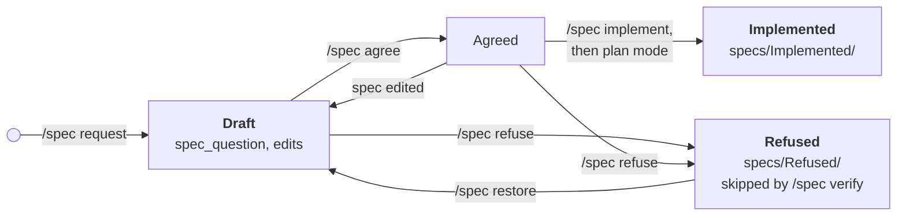
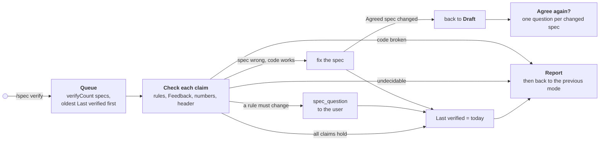

# pi-spec-mode ✎

[](https://www.npmjs.com/package/pi-spec-mode)
[](LICENSE)
[](https://pi.dev)
[](https://nodejs.org)

A [pi](https://pi.dev) extension that adds a **specification mode**: write a feature spec with the agent, agree it, keep it true to the code, and hand it to plan mode to build.

A spec says what a feature is and how it behaves; it never describes code.

## Install

```bash
pi install npm:pi-spec-mode        # or: pi install git:github.com/psychobarge/pi-spec-mode
pi -e ./                           # try a local checkout
```

`/spec implement` also needs [`@narumitw/pi-plan-mode`](https://www.npmjs.com/package/@narumitw/pi-plan-mode). Everything else works without it.

## Use

| Command | What it does |
|---|---|
| `/spec` | Menu fitted to the current state, listing the same commands as `/spec ` + Tab (with a short detail in parentheses); implement, restore, and agree or refuse with no spec in progress, then pick the spec from a list of the ones they accept (↑ on the first entry jumps to the last, ↓ on the last back to the first; type the number instead if you prefer: `/spec implement 0003`) |
| `/spec start` | Enter spec mode, send nothing |
| `/spec <request>` | Enter spec mode and send the request. A request may start with a command word (`/spec verify that login works offline`); `/spec agree` or `/spec verify` followed by a spec number or file name is always the command, even when no spec matches |
| `/spec list` | Every spec, refused ones included: number, `Status`, `Last verified` and how many days ago |
| `/spec agree [spec]` | Set the spec shown in the footer to `Agreed` and leave spec mode; with a spec name, agree that `Draft` spec (`/spec agree 0003`) whatever the mode, without closing the spec being written |
| `/spec refuse [spec]` | Set a spec (default: the one in the footer) to `Refused` and move it to `specs/Refused/`: kept, but ignored by `/spec verify` and the agent. Refusing the spec in the footer leaves spec mode |
| `/spec restore <spec>` | Move a refused spec back to `specs/` as `Draft` |
| `/spec verify` | Check the `verifyCount` specs verified longest ago against the code |
| `/spec verify <spec>` | Check one spec against the code, even if already verified today |
| `/spec implement <spec>` | Hand an `Agreed` spec to plan mode |
| `/spec template` | Create `specs/spec_template.md`, adapted to the project by the agent (asks first) |
| `/spec exit` | Leave spec mode |
| `/spec settings` | Show the effective settings and change them from a menu |

While in spec mode the footer shows `✎ spec-mode` in blue (then `✎ spec-mode 0003 · Draft`); nothing when off. The agent can read the whole project, run only read-only shell commands, and write only Markdown files inside the specs folder. Before calling `spec_complete`, it checks the new spec against existing ones: it sees each spec's title and Goal sentence only, reads in full the `Agreed` and `Implemented` specs on the same subject, and asks about any contradicting rule. This keeps the context small but is not exhaustive: a conflicting rule in a spec whose title and goal look unrelated is missed (`/spec verify` remains the safety net). It asks decisions through `spec_question` and calls `spec_complete` when the spec is ready, which opens an **Agree / Keep discussing / Leave** menu.

Specs live in `specs/NNNN_spec_<feature>.md`; implemented ones move to `specs/Implemented/`, refused ones to `specs/Refused/` (also when you set `Status` to `Refused` by hand, which leaves spec mode if it was the spec being written).



`/spec verify` runs over every spec outside `Refused/`, oldest check first, and fixes a spec that drifted from the code. An `Agreed` spec it had to edit goes back to `Draft`, and the run ends by asking you, once per spec changed that way, whether to agree it again (`Agree again` / `Keep Draft`); a spec only stamped `Last verified` stays `Agreed` and is not offered, and so is a spec that was already `Draft`. Answering `Keep Draft` is not final: `/spec agree <spec>` agrees it later.



## Make your own template (do it)

The [bundled template](templates/spec_template.md) is deliberately generic. Spec quality comes from a template that speaks your project's language: a game needs "feel" and balance numbers, an API needs contracts and error codes, a mobile app needs screens and offline states. For the level of detail expected, read [a complete spec](examples/0001_spec_dark_mode.md): deliberately barebone — short sections, one rule per line, one number with its reason. Real specs usually say more.

```
/spec template
```

asks first, because it starts a decision you own: the generic template is copied to `specs/spec_template.md` as the starting point, then the agent quickly looks at the project (type, stack, domain, existing specs) and rewrites the file for it. Answer `No` and you are offered the plain copy instead.

**Reread the result.** `/spec agree` checks every spec against this template, so a rule that is wrong here makes every spec wrong: the agent tells you what it changed, and so does spec mode when the run ends. Rename sections, rewrite the hints for your domain, delete what never applies. Spec mode uses the project's template whenever it exists, and warns you each time it falls back to the generic one. Agreeing a spec checks it against the template's own sections, so any section layout works; a section left empty is refused (write "None"). The agent can only change the template during that `/spec template` run: otherwise it is yours, edit it yourself or ask the agent outside spec mode.

## Settings

`~/.pi/agent/pi-spec-mode.json`, overridden per project by `.pi/pi-spec-mode.json` (read only in trusted projects). Edit them by hand, or run `/spec settings`: pick a setting, type its value (empty keeps it), then pick the file it goes to (this project or all projects; an untrusted project can only use the global file). A value the rules below refuse is not saved, and a settings file that is not valid JSON is left unchanged.


```json
{
  "specsDir": "specs",
  "language": "English",
  "verifyCount": 2,
  "renameSession": false,
  "renamePlanSession": false
}
```

`specsDir` is the folder specs live in, relative to the project. A path outside the project, or an existing file, is ignored with a warning and `"specs"` is used.

`language` is the language specs are written in, whatever the language of the conversation. Anything but a non-empty string is ignored with a warning and `"English"` is used.

`verifyCount` is how many specs `/spec verify` checks per run.

`renameSession`, when `true`, renames the session `spec NNNN creation` as soon as the agent creates spec `NNNN` in spec mode (the name `/resume` shows). Editing an existing spec does not rename it. Anything but `true` or `false` is ignored with a warning and `false` is used.

`renamePlanSession`, when `true`, renames the session `spec NNNN planning` just before `/spec implement` (typed or picked from the `/spec` menu) hands spec `NNNN` to plan mode. Same rules as `renameSession`; off by default.

## Develop

```bash
npm install
npm test          # node --test, no build step: pi loads the TypeScript directly
npm run typecheck
```

## Known limitations

- **Conflict check depends on section names.** The existing specs are summarised by their H1 title and the first line of a section named `Goal` (with or without a number, e.g. `## 2. Goal`). If your template renames it (`## Objectif`, `## Purpose`…), each spec is listed by its title only, and conflicts are detected less reliably. Keep a heading named `Goal` in your template to get the full summary.
- **A spec that is a symbolic link is ignored.** `/spec list`, `/spec agree`, `/spec verify`, `/spec refuse` and the sweep of refused specs skip it: acting on it would write to the link's target, outside the specs folder. Keep the spec file itself in the specs folder.
- **Conflict check is a model instruction, not code.** The agent is asked to read the related specs and report contradictions; nothing enforces that it does. `/spec verify` remains the safety net.

## Changelog

See [CHANGELOG.md](CHANGELOG.md) for version history.

## My other pi extensions & tools

| Extension/tool | What it does | Install |
|---|---|---|
| [pi-deepseek-peak](https://github.com/psychobarge/pi-deepseek-peak) | Shows DeepSeek peak-hour status and corrects session prices | `pi install npm:pi-deepseek-peak` |
| [pi-deepseek-vision](https://github.com/psychobarge/pi-deepseek-vision) | Gives DeepSeek vision through a local or remote vision LLM | `pi install npm:pi-deepseek-vision` |
| [pi-sessions](https://github.com/psychobarge/pi-sessions) | Terminal UI for browsing, previewing, resuming and managing Pi sessions | `pipx install pi-sessions-tui` |

## License

MIT

