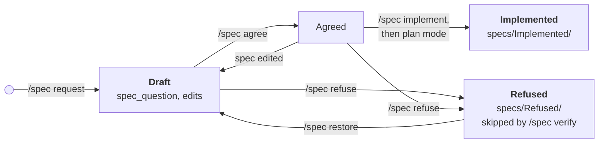

# pi-spec-mode

[](https://www.npmjs.com/package/pi-spec-mode)
[](LICENSE)
[](https://pi.dev)
[](https://nodejs.org)

A [pi](https://pi.dev) extension that adds a **spec mode**: write a feature spec with the agent, agree it, keep it true to the code, and hand it to plan mode to build.

A spec says what a feature is and how it behaves; it never describes code.

## Install

```bash
pi install npm:pi-spec-mode        # or: pi install git:github.com/psychobarge/pi-spec-mode
pi -e ./                           # try a local checkout
```

`/spec implement` also needs [`@narumitw/pi-plan-mode`](https://www.npmjs.com/package/@narumitw/pi-plan-mode). Everything else works without it.

## Use

| Command | What it does |
|---|---|
| `/spec` | Menu fitted to the current state |
| `/spec start` | Enter spec mode, send nothing |
| `/spec <request>` | Enter spec mode and send the request |
| `/spec agree` | Set the spec shown in the footer to `Agreed` and leave spec mode |
| `/spec refuse [spec]` | Set a spec (default: the one in the footer) to `Refused` and move it to `specs/Refused/`: kept, but ignored by `/spec verify` and the agent |
| `/spec restore <spec>` | Move a refused spec back to `specs/` as `Draft` |
| `/spec verify` | Check the `verifyCount` specs verified longest ago against the code |
| `/spec implement <spec>` | Hand an `Agreed` spec to plan mode |
| `/spec template` | Copy the generic template to `specs/spec_template.md` to adapt it |
| `/spec exit` | Leave spec mode |
| `/spec settings` | Show the effective settings |

While in spec mode the footer shows `spec-mode` (then `spec-mode 0003 · Draft`); nothing when off. The agent can read the whole project, run only read-only shell commands, and write only inside the specs folder. It asks decisions through `spec_question` and calls `spec_complete` when the spec is ready, which opens an **Agree / Keep discussing / Leave** menu.

Specs live in `specs/NNNN_spec_<feature>.md`; implemented ones move to `specs/Implemented/`, refused ones to `specs/Refused/` (also when you set `Status` to `Refused` by hand).



`/spec verify` runs over every spec outside `Refused/`, oldest check first, and fixes a spec that drifted from the code.

## Make your own template (do it)

The [bundled template](templates/spec_template.md) is deliberately generic. Spec quality comes from a template that speaks your project's language: a game needs "feel" and balance numbers, an API needs contracts and error codes, a mobile app needs screens and offline states.

```
/spec template
```

copies the generic template to `specs/spec_template.md`. Rename its sections, rewrite the italic hints for your domain, delete what never applies. Spec mode uses the project's template whenever it exists, and warns you each time it falls back to the generic one. Agreeing a spec checks it against the template's own sections, so any section layout works.

## Settings

`~/.pi/agent/pi-spec-mode.json`, overridden per project by `.pi/pi-spec-mode.json` (read only in trusted projects):

```json
{
  "specsDir": "specs",
  "language": "English",
  "verifyCount": 2
}
```

`language` is the language specs are written in, whatever the language of the conversation.

`verifyCount` is how many specs `/spec verify` checks per run.

## Develop

```bash
npm install
npm test          # node --test, no build step: pi loads the TypeScript directly
npm run typecheck
```
